> **Copyright (c) 2026 Simon C.-Y. Wong. All rights reserved.**

<div align="center">

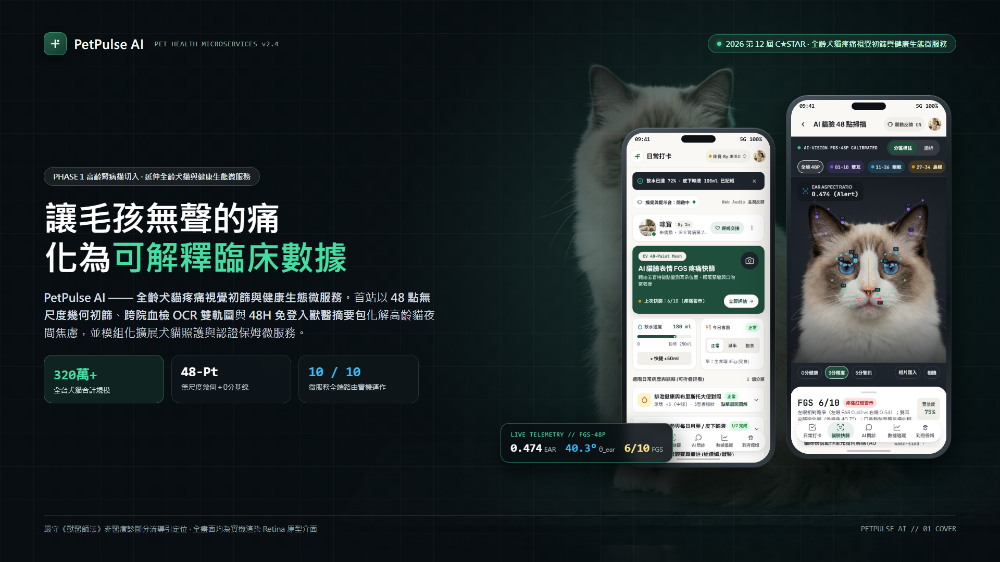

# PetPulse AI —— 全齡犬貓疼痛視覺初篩與健康生態微服務

**以可解釋 48 點無尺度幾何初篩 × 跨院紙本血檢 OCR 雙軌圖 × 48 小時免登入獸醫摘要包，打造從居家照護到診間預審的伴侶動物健康生態微服務**

[](package.json)
[](src/workers/fgsOnnxWorker.ts)
[](workers/api-gateway.ts)
[](supabase/migrations/0001_init.sql)
[](#合規邊界與誠實揭露聲明)

[核心痛點與切入策略](#一為什麼做核心痛點與分期定位) •
[核心技術 48 點幾何](#二核心技術48-點無尺度幾何演算與個體-0-分基線) •
[實機畫面總覽](#三實機系統介面總覽retina-2x) •
[混合雲微服務架構](#四edge-first-混合雲微服務架構與目錄結構) •
[本地啟動與驗證](#五本地開發打包與驗證指令) •
[競賽提案與簡報素材](#六cstar-提案簡報影片與企劃文件)

</div>

---

> **《獸醫師法》合規與非診斷聲明**  
> 本系統（**PetPulse AI**）嚴格定位為「居家健康數據管理、跨院檢驗紀錄彙整與就醫前分流導引微服務工具」，**不提供醫療診斷、不開立處方、亦不替代執業獸醫師之臨床診察**。所有視覺初篩與數值提醒僅作為是否提前就醫及診間溝通之客觀參考。

---

## 一、為什麼做：核心痛點與分期定位

根據**中華民國農業部「全國家犬貓飼養數量調查」**，全國家貓推估數量由 2023 年約 `131.1 萬隻`（1,311,449 隻）成長至 2025 年約 **`174.2 萬隻`（1,742,033 隻）**，兩年增幅 **`+32.8%`** 並**首度超越家犬（約 `146 萬隻`）**；全台犬貓伴侶動物總數已突破 **`320 萬隻`**，家貓強制寵物登記率亦提升至 **`66.48%`**。

在 **PetPulse AI —— 全齡犬貓疼痛視覺初篩與健康生態微服務** 的統一微服務架構下，我們採取務實的 **「高剛需海灘頭 → 全齡健康生態擴張」** 策略：

| 階段定位 | 目標客群與涵蓋模組 | 策略理由 |
| :--- | :--- | :--- |
| **Phase 1 核心 MVP** *(已實作可操作原型)* | 鎖定**台灣高齡與慢性腎病貓（IRIS Stage 2–3）飼主**：<br/>1. 單手 3 秒日常飲水／食慾／排泄／輸液快記<br/>2. AI 48 點 FGS 幾何疼痛初篩＋自家毛孩 0 分基線<br/>3. 跨院紙本血檢 OCR 覆核＋`CREA`×飲水雙軌圖<br/>4. 48 小時免登入獸醫唯讀摘要包（`/packet/:shareToken`） | 集中解決犬貓照護中最高頻、夜間急診焦慮最強、看診跨院斷鏈最嚴重的剛性閉環，避免初期功能過於發散。 |
| **Phase 2 健康生態微服務** *(遠期擴展規劃／含互動介面原型)* | 依同一微服務底座橫向擴展至：<br/>1. **全齡犬隻**疼痛／表情／步態視覺評估與多寵家族管理<br/>2. **認證醫療保姆交接微服務**（`/app/sitters`、`/sitter/portal`）<br/>3. **合作動物醫院預審 CRM 看板**（`/admin/clinic-crm`） | 待 Phase 1 高齡貓付費留存與單位經濟實證達標後，再逐步開放全齡犬貓專屬模型與 B2B 院所／保姆協作生態。 |

### 直擊兩大高頻臨床痛點

1. **毛孩極度忍痛引發「夜間急診分流焦慮」**：高齡與腎病貓疼痛初期僅表現為微幅瞇眼、耳朵外壓或食慾微降。半夜該冒著外出劇烈緊迫與高昂急診費衝醫院，還是在家觀望怕延誤病情？飼主長期缺乏透明的量化依據。
2. **「跨院紙本血檢」與「日常飲水」嚴重斷鏈**：不同動物醫院機台（IDEXX、Abaxis、Fujifilm）輸出分散紙本單據，導致 `CREA / BUN / SDMA` 無法與每日飲水、皮下輸液、體重趨勢對齊，看診 10 分鐘內極難完整口述。

---

## 二、核心技術：48 點無尺度幾何演算與個體 0 分基線

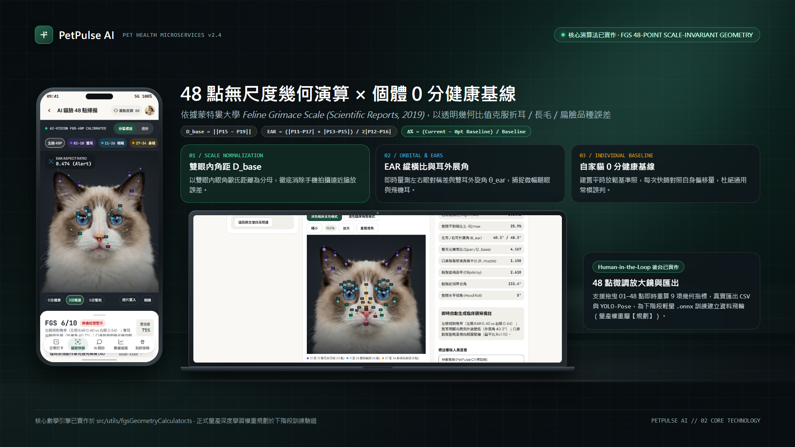

依據蒙特婁大學獸醫學院發表於 *Scientific Reports*（2019）的 **Feline Grimace Scale（FGS）** 五大臉部動作單元（總分 `0–10`，介入參考門檻 $\ge 4/10$），本專案於 [`src/utils/fgsGeometryCalculator.ts`](src/utils/fgsGeometryCalculator.ts) 實作純數學可解釋幾何引擎，拒絕黑箱給分：

### 關鍵無尺度幾何指標公式

* **基準尺度正規化分母（$D_{\text{base}}$）**：以左眼內角點 `P15` 與右眼內角點 `P19` 之歐氏距離為基準，徹底消除手機拍攝遠近縮放誤差：
  $$D_{\text{base}} = \| P_{15} - P_{19} \|_2$$
* **雙眼縱橫比（Eye Aspect Ratio, EAR）與雙眼不對稱度**：即時偵測早期單眼或雙眼眼眶收緊（`P11–P18` 左眼、`P19–P26` 右眼）：
  $$\text{EAR}_{\text{left}} = \frac{\|P_{13} - P_{17}\| + \|P_{14} - P_{16}\|}{2 \cdot \|P_{11} - P_{15}\|}, \quad \text{Asymmetry} = \frac{|\text{EAR}_L - \text{EAR}_R|}{\max(\text{EAR}_L, \text{EAR}_R)}$$
* **雙耳外展角（$\theta_{\text{ear}}$）與耳尖跨距比**：量測耳根與耳尖連線之水平外旋角度（捕捉微幅飛機耳）。
* **口鼻鬍鬚墊扁平比（$R_{\text{muzzle}}$）與前傾聚合角**：捕捉口鼻緊張拉寬與鬍鬚前擠特徵。
* **個體化 0 分健康基線（Individual 0-pt Baseline）**：支援飼主在毛孩平時放鬆狀態建立個人基準照，後續每次快篩直接比對相對自身基線的偏移量（$\Delta\%$），有效克服布偶、折耳、扁臉與長毛貓犬天生五官結構差異。

---

## 三、實機系統介面總覽（Retina @2x）

全站採用低焦慮「**Warm Clinical Paper 溫潤臨床紙感**」（`#FAF8F5` 暖米白底色搭配 `#1F4E3D` 鼠尾草深綠主色，所有血檢數據與幾何座標強制等寬 `tabular-nums` 對齊），並通過全站 10 條前後台路由在 `320px–1440px` 寬度的響應式與無障礙檢驗。

### 3.1 居家照護到診間預審：四步驟實機閉環（Mobile App）

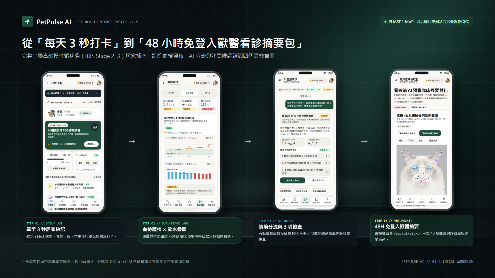

<div align="center">
<table>
  <tr>
    <th width="25%">① 日常快記 (<code>/app/home</code>)</th>
    <th width="25%">② 48 點快篩 (<code>/app/fgs-scan</code>)</th>
    <th width="25%">③ 跨院血檢 (<code>/app/trends</code>)</th>
    <th width="25%">④ AI 問診分流 (<code>/app/chat</code>)</th>
  </tr>
  <tr>
    <td align="center">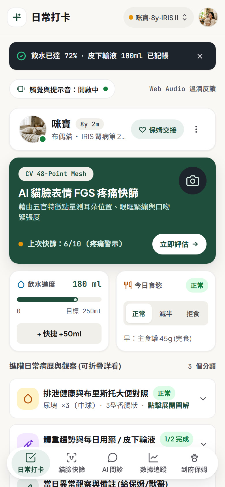</td>
    <td align="center">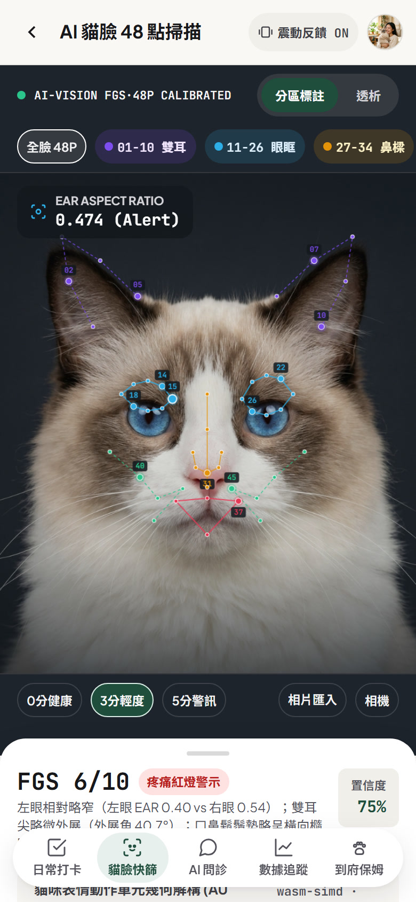</td>
    <td align="center">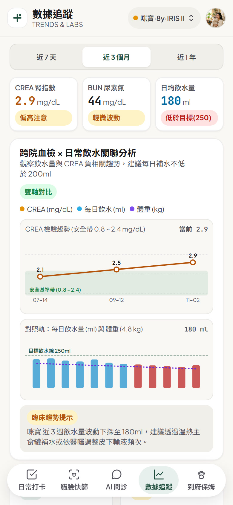</td>
    <td align="center">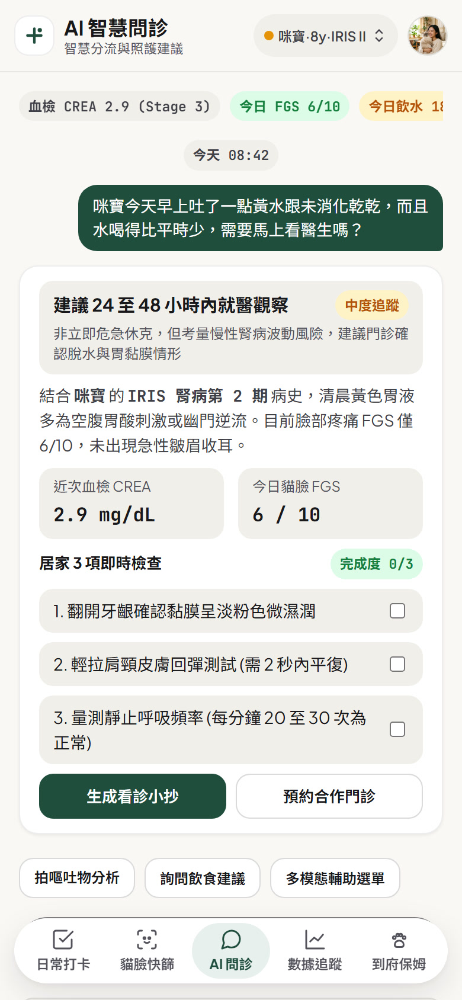</td>
  </tr>
  <tr>
    <td>單手 <code>+50ml</code> 飲水進度條、食慾三段、布里斯托便況、輸液紀錄、Web Audio 溫潤反饋音與多犬貓切換。</td>
    <td>暗房五色 48 點標註網格、即時 EAR 遙測、0/3/5 分情境切換、WebRTC 相機 EXIF 自動轉正與 0 分基線設定。</td>
    <td>原圖並排人工覆核表單杜絕小數點錯讀，並以雙軌圖對照 <code>CREA</code> 安全帶與每日飲水／體重變化。</td>
    <td>自動掛載近期血檢與當日 FGS 分數，輸出三級緊急度建議、居家 3 項即時檢查與看診摘要包生成入口。</td>
  </tr>
</table>
</div>

### 3.2 標註資料飛輪 × 48 小時看診包 × Phase 2 生態工作台

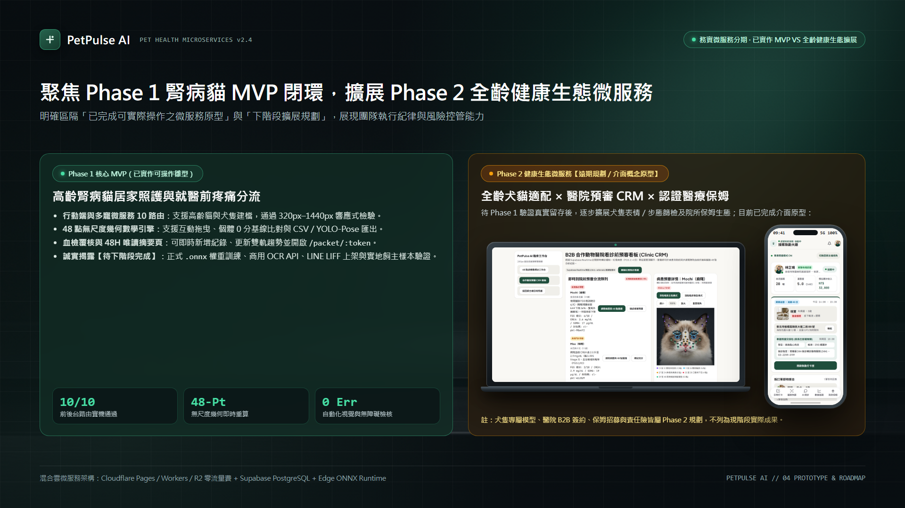

<div align="center">
<table>
  <tr>
    <th width="34%">Human-in-the-Loop 標註後台 (<code>/admin/fgs-dataset</code>)</th>
    <th width="34%">合作醫院預審 CRM 原型 (<code>/admin/clinic-crm</code>)</th>
    <th width="16%">48H 獸醫摘要包 (<code>/packet/:token</code>)</th>
    <th width="16%">認證保姆執勤端 (<code>/sitter/portal</code>)</th>
  </tr>
  <tr>
    <td align="center">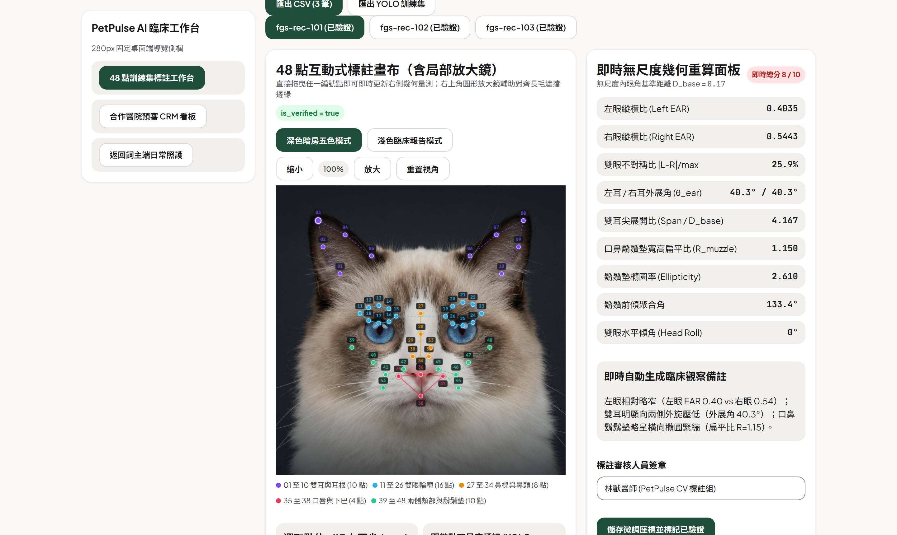</td>
    <td align="center">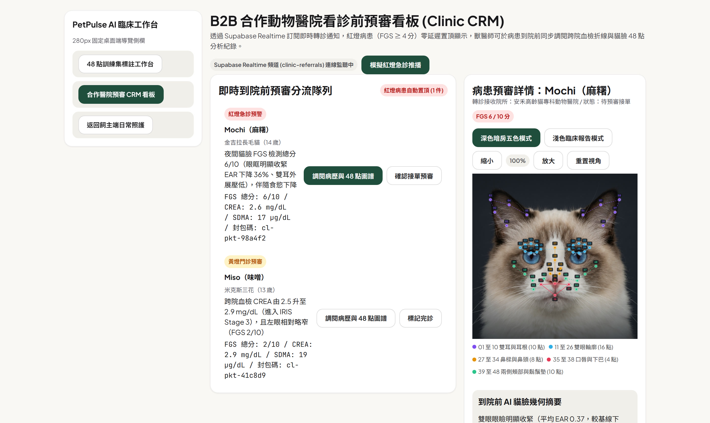</td>
    <td align="center">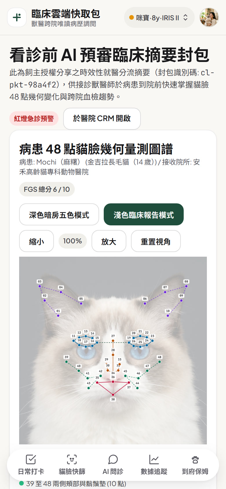</td>
    <td align="center">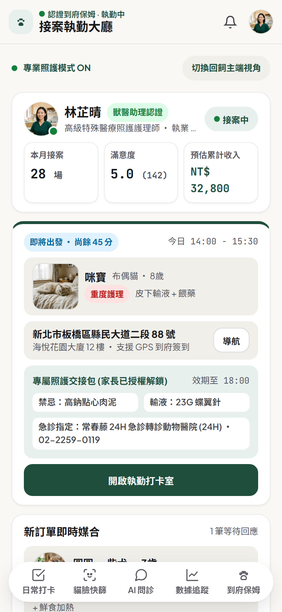</td>
  </tr>
  <tr>
    <td>拖曳 01–48 號關鍵點、圓形放大鏡輔助長毛遮擋對齊、右側即時重算 9 項幾何指標，並實際下載標準 <code>CSV</code> 與 <code>YOLO-Pose</code> 訓練集。</td>
    <td>透過 Supabase Realtime 與跨頁廣播機制零延遲置頂紅燈病患，同屏調閱 48 點圖譜與跨院血檢指標（Phase 2 預審介面原型）。</td>
    <td>無須獸醫註冊登入即可於 48 小時內調閱 48 點貓臉淺色臨床圖譜、無尺度比值與跨院血檢摘要，縮短診間口述成本。</td>
    <td>展示 Phase 2 到府醫療級照護交接清單、定位打卡、離戶前 FGS 平安回報與交接醫囑摘要。</td>
  </tr>
</table>
</div>

### 3.3 全站系統路由清單（[`src/App.tsx`](src/App.tsx)）

| 分類 | 路由路徑 | 功能說明 |
| :--- | :--- | :--- |
| **飼主日常 MVP** | `/app/home` *(別名 `/app/daily`)* | 多犬貓切換（咪寶 / 拿鐵 / 圓圓柴犬）、飲水 `+50ml` 快記、食慾、布里斯托分類與皮下輸液紀錄 |
| **疼痛視覺初篩** | `/app/fgs-scan` *(別名 `/app/fgs-scanner`)* | 48 點無尺度幾何評分、暗房/臨床畫布切換、鏡頭/相片匯入與 EXIF 轉正、個體 0 分基線儲存 |
| **跨院血檢趨勢** | `/app/trends` *(別名 `/app/blood-test`)* | `CREA / BUN / SDMA` 安全帶雙軌圖、原圖並列人工確認表單、一鍵生成 48 小時看診摘要連結 |
| **AI 問診分流** | `/app/chat` | 結合血檢與 FGS 指標之就醫前紅/黃/綠三級分流與居家 3 項檢查清單 |
| **保姆／轉診** | `/app/sitters` *(別名 `/app/sitter`, `/app/clinics`)* | 保姆到府照護交接視角與合作醫院時效性轉診分享 |
| **毛孩檔案** | `/app/profile` | 健康檔案、0 分健康基準照管理與看診卡生成 |
| **免登入摘要頁** | `/packet/:shareToken` | 供接診獸醫師免登入唯讀調閱之 48 小時時效性看診摘要包 |
| **標註工作台** | `/admin/fgs-dataset` | 桌面端 280px 側欄、48 點拖拽微調放大鏡、`CSV` / `YOLO-Pose JSON` 匯出 |
| **醫院 CRM 原型** | `/admin/clinic-crm` | B2B 動物醫院到院前預審分流看板（Supabase Realtime + `BroadcastChannel` 模擬推播） |
| **認證與保姆端** | `/login`, `/sitter/portal` | LINE LIFF / Google 登入畫面與到府保姆執勤大廳原型 |

---

## 四、Edge-First 混合雲微服務架構與目錄結構

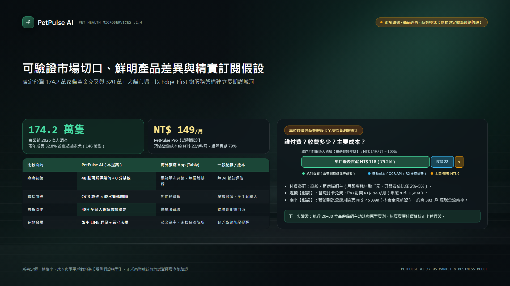

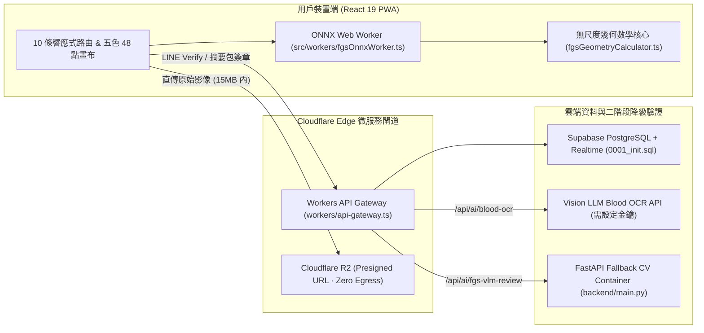

### 專案目錄結構

```text
petpulse-ai/
├── index.html                           # PetPulse AI 網頁入口與字體/SEO 設定
├── package.json                         # React 19 + TypeScript + Vite 腳本與依賴
├── wrangler.toml                        # Cloudflare Workers 與 R2 儲存桶設定
├── .env.example                         # 前端與後端環境變數範本
├── src/
│   ├── App.tsx                          # 全站 10+ 路由與合規免責頁尾
│   ├── components/
│   │   ├── FGSAnnotationCanvas.tsx      # 五色 48 點標註 Canvas、暗房/臨床切換與局部放大鏡
│   │   ├── shell/                       # TopPetHeader (多寵切換與桌機端點列) / BottomTabBar
│   │   └── overlays/                    # ActionSheetModal / BottomSheetDrawer / SystemSnackbar
│   ├── hooks/                           # useHapticAudio / useR2Upload / useRealtimeReferrals
│   ├── pages/                           # 各大消費者頁、獸醫唯讀摘要頁、保姆端與雙後台頁
│   ├── services/                        # carelinkStore (本地/Realtime 持久化與匯出) / onnxEngine
│   ├── utils/                           # fgsGeometryCalculator.ts / exifOrientation.ts
│   └── workers/fgsOnnxWorker.ts         # 二階段貓臉 48 點推論 Web Worker 封裝
├── workers/api-gateway.ts               # Cloudflare Workers 閘道 (LINE Auth / R2 Presign / Blood OCR / Fallback)
├── supabase/migrations/0001_init.sql    # pets / fgs_records / blood_test_records / clinic_referrals 資料表
├── backend/                             # Python FastAPI 降級推論服務與 Dockerfile (Railway / Modal)
├── docs/screenshots/                    # README 圖文展示用 @2x Retina 實機畫面
├── public/images/                       # 高質感毛孩實拍與 MedTech 攝影素材
├── scripts/
│   ├── build-cstar-media-kit.mjs        # 產出 5 張 16:9 PNG + 10 頁簡報 PDF + 8 幕 1080p MP4 展示片
│   ├── generate-cstar-pdf.mjs           # 產出 5 頁 A4 競賽正式修訂企劃書 PDF
│   ├── capture-retina-shots.mjs         # 無頭 Edge 自動擷取 @2x Retina 前後台實機畫面
│   └── sloplint.mjs / sloplint-render.mjs
└── submission/                          # C★STAR 競賽交付檔（A4 企劃書、16:9 簡報、展示圖、MP4 與表單文案）
```

---

## 五、本地開發、打包與驗證指令

### 1. 前端 Web App 本地運行

```bash
# 1. 安裝依賴
npm install

# 2. 啟動本地開發伺服器 (http://localhost:5173)
npm run dev

# 3. 執行 TypeScript 檢查與生產級打包
npm run build

# 4. 啟動生產預覽 (http://localhost:4173)
npm run preview
```

### 2. 設計規範檢查與提案素材一鍵重製

```bash
# Hallmark 靜態樣式檢查
npm run sloplint

# 含無頭瀏覽器跨視口渲染檢查 (320px–1440px)
npm run sloplint:render

# 重擷全站 @2x Retina 實機截圖
node scripts/capture-retina-shots.mjs

# 重建全套 C★STAR 素材（5 張 16:9 PNG + 10 頁 16:9 簡報 PDF + 8 幕 1080p MP4）
node scripts/build-cstar-media-kit.mjs

# 重建 5 頁 A4 正式修訂企劃書 PDF
node scripts/generate-cstar-pdf.mjs
```

### 3. 混合雲環境部署參考（進階階段）

1. **Supabase PostgreSQL & Realtime**：於 Supabase SQL Editor 執行 [`supabase/migrations/0001_init.sql`](supabase/migrations/0001_init.sql) 建立 4 張資料表並開啟 Realtime Publication。
2. **Cloudflare R2 & Workers**：參考 [`.env.example`](.env.example) 與 [`wrangler.toml`](wrangler.toml) 配置 R2 儲存桶與 Secrets，部署 [`workers/api-gateway.ts`](workers/api-gateway.ts)。
3. **Python FastAPI Fallback 容器**：透過 [`backend/Dockerfile`](backend/Dockerfile) 部署至 Railway 或 Modal，為低信心度長毛遮擋情境提供雲端二次座標平滑備援。

---

## 六、C★STAR 提案簡報、影片與企劃文件

本倉庫已同步收納 2026 第 12 屆 C★STAR 創意創新創客大賽完整交付套件（位於 [`submission/`](submission) 目錄，均已移除個人學號與校系可識別資訊）：

* **10 頁 16:9 旗艦科技商品提案簡報 PDF（`7.04 MB`）**：[`submission/cstar_assets/黃澤然_PetPulse_AI_CStar提案簡報_16x9.pdf`](submission/cstar_assets/黃澤然_PetPulse_AI_CStar提案簡報_16x9.pdf)
* **5 頁 A4 正式修訂企劃書 PDF（`3.49 MB`）**：[`submission/黃澤然_PetPulse_AI_全齡犬貓疼痛視覺初篩與健康生態微服務.pdf`](submission/黃澤然_PetPulse_AI_全齡犬貓疼痛視覺初篩與健康生態微服務.pdf)
* **60 秒 Full-HD 產品發表展示影片（1080p / 8 幕運鏡 / 四和弦環境配樂）**：[`submission/cstar_assets/video/PetPulse_AI_CStar_Product_Demo_1080p.mp4`](submission/cstar_assets/video/PetPulse_AI_CStar_Product_Demo_1080p.mp4)
* **5 張 `1920×1080` 參賽展示圖**：[`submission/cstar_assets/images/`](submission/cstar_assets/images)
* **`zanzan.io/cstar/submission` 一鍵表單文案與 60 秒配音腳本**：[`submission/cstar_assets/zanzan_表單填寫與影片腳本.md`](submission/cstar_assets/zanzan_表單填寫與影片腳本.md)

---

## 合規邊界與誠實揭露聲明

為維持工程誠信與競賽評審透明度，下方明確區分本專案**已完成可實機操作之項目**與**尚處規劃／模擬階段之項目**：

| 模組與項目 | 現階段真實進度（已實作可操作） | 下階段規劃／模擬邊界（`【規劃／假設】`） |
| :--- | :--- | :--- |
| **前端介面與多寵打卡** | 10+ 路由 RWD 互動、飲水／食慾／布里斯托／輸液快記、Web Audio 觸覺音 | LINE LIFF 正式上架與官方帳號排程推播待正式環境串接 |
| **48 點無尺度幾何運算** | `fgsGeometryCalculator.ts` 真實計算引擎、五色拖曳畫布、`CSV`/`YOLO-Pose` 匯出 | **量產級 `.onnx` 模型權重尚未完成大樣本訓練與臨床準確率驗證**；現以推論框架＋預設點位微調展示運算閉環 |
| **血檢 OCR 與摘要包** | 原圖並排人工確認表單、雙軌 SVG 圖表、`/packet/:shareToken` 唯讀摘要頁 | 外部商用 Vision LLM API 金鑰串接與跨院單據自動辨識率實測 |
| **商業模式與市場驗證** | 農業部與蒙特婁大學 FGS 公開數據查核、3 分鐘實測問卷協議定稿 | **PetPulse Pro（`NT$ 149/月`、變動成本 `NT$ 22`、兩平 `382 戶`）全屬假設模型**；第一手飼主樣本回收執行中 |
| **全齡犬隻評估與 O2O 生態** | 多犬貓切換介面（含犬隻檔案）、`/sitter/portal`、`/admin/clinic-crm` 互動原型 | 犬隻專屬疼痛模型、到府保姆招募認證、責任險與醫院 B2B 簽約列為 Phase 2 擴展規劃 |

---

<div align="center">

**Copyright (c) 2026 Simon C.-Y. Wong. All rights reserved.**

</div>
